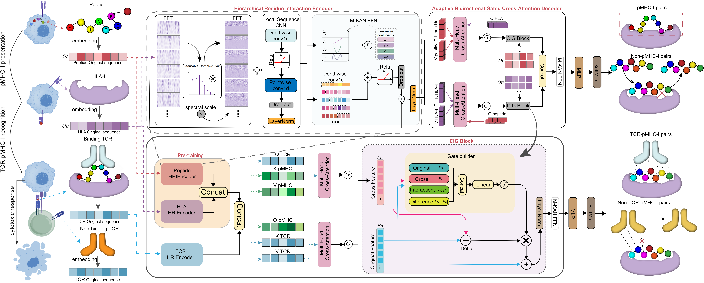

# AdaMCR-KAN


## Environment Setup

### Requirements

AdaMCR-KAN is implemented in Python and PyTorch. The recommended environment is listed below.

| Component | Version |
|---|---|
| Python | 3.11 |
| PyTorch | 2.4.0+cu118 |
| TorchVision | 0.19.0+cu118 |
| TorchAudio | 2.4.0+cu118 |
| CUDA | 11.8 |
| Transformers | 4.36.2 |
| NumPy | 1.26.4 |
| scikit-learn | 1.9.0 |

### Installation

Create and activate the Conda environment:

```bash
conda create -n AdaMCR_KAN python=3.11 -y
conda activate AdaMCR_KAN
```

Install the required dependencies using pip:

```bash
python -m pip install --upgrade pip
python -m pip install -r requirements.txt
```

## Abstract
TCR–pMHC-I recognition is governed by intricate residue-wise cross-molecular interactions and sequence dependencies, and the extreme polymorphism of HLA-I molecules brings great difficulty to accurate prediction. We propose AdaMCR-KAN, a KAN-based model for TCR–pMHC-I recognition prediction. It uses a hierarchical residue interaction encoder (HRIEncoder) to extract multi-level sequence features, bidirectional cross-attention with adaptive head gating, and a novel cross-interaction gating (CIG) module to dynamically filter redundant interactions and emphasize key binding patterns. Benchmark results show AdaMCR-KAN achieves superior performance and strong generalization across diverse peptides, HLA alleles and test scenarios. Further motif analysis and saturation mutagenesis validation confirm the model learns biologically meaningful residue binding preferences.
